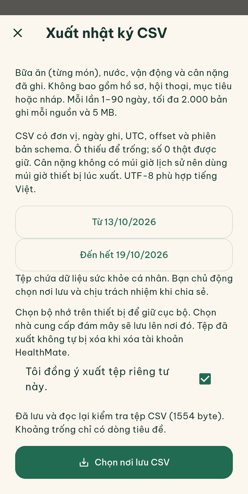
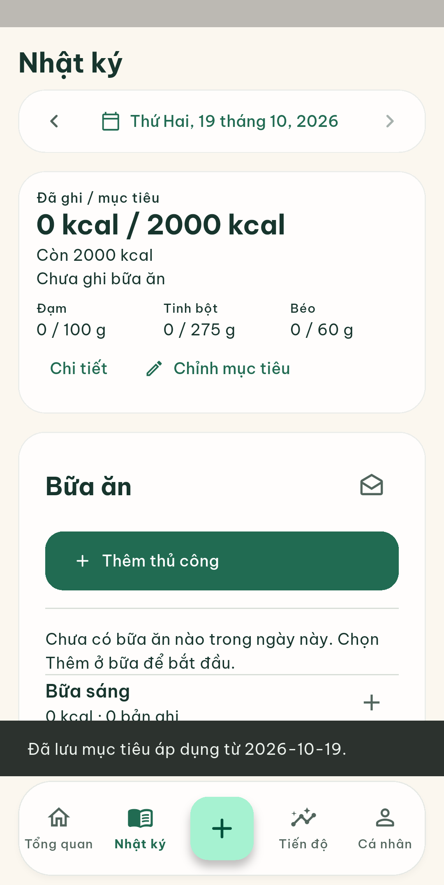

# H7 — Nháp và xuất dữ liệu trên Android QA

Thiết bị: AVD HealthMateMaintenanceQA, emulator-5580, Android API30/x86_64.
Backend: demo-healthmate-rules, Auth9099/Firestore8080; AI tắt, dữ liệu tổng hợp.
Không dùng tài khoản production hoặc điện thoại thật.

Lượt cuối `tool/test_h7_android.ps1`: phase1 **12s**, force-stop không xóa app data,
phase2 **32s**, runner exit0. Có SDK Firestore thật và Android Keystore/SAF thật.

- Phase1: tạo món QA qua form, kcal150, fiber3g, macros chưa biết; JSON đã giữ mã
  hóa, Firestore chưa có bữa. Đóng tiến trình bằng adb, khởi chạy lại cùng dữ liệu.
- Phase2: chủ động khôi phục đúng ID/khẩu phần/ngày/bữa; chưa tự gửi. Thử lưu mất
  mạng rồi kết nối lại và transaction retry cùng ID; sau xác nhận chỉ đúng một bữa.
  Commit trước acknowledgement được tái hiện, không sinh thêm ID để né xung đột.
- Export UI: đồng ý riêng tư → OS DocumentsUI Save; write/readback khớp1554byte.
  `tool/verify_h7_export.ps1` đọc file thật Downloads và so từng byte với CSV dựng
  từ repository thật; BOM, meal/water/activity/weight và missing nutrient đúng.
- Tài khoản B: form không có món A, query SDK lấy nhật ký A bị Rules từ chối.
- Khi OS picker đang mở: chuyển SDK sang B, bấm Save; dữ liệu A không được ghi,
  document rỗng vừa tạo được dọn. Dùng runAsync cho phần SDK/picker khi Flutter
  tạm ngừng frame; không thay picker bằng mock.
- Xóa A: Firestore trước, file/khóa nháp A sau, rồi Auth; B còn nháp. Xóa B sau
  kiểm tra cũng dọn file đúng UID. Không xóa các bản CSV đã xuất.

Core Android chạy lại221s/10checkpoint/H1–H6 qua; recent vẫn3tap. Bỏ nháp nằm
trên AppBar khi cuộn. Test360/chữ2/tối và lỗi xóa/retry đã qua. Full Flutter cuối
454/454 (43s); analyze sạch17.4s. Không cần deploy/index/package mới cho H7.

Ảnh đã xem: nội dung riêng tư và ngày đọc được, consent rõ, kết quả cùng nút lưu
không bị cắt. Widget matrix riêng có18trường hợp xuất (360/390/412, chữ1/1.5/2,
sáng/tối), thực sự cuộn/bấm consent và nút xuất; không chỉ bắt exception.

Cần xem thêm trên máy thật: nháp sau vuốt tắt/khởi động lại, bàn phím/chữ lớn,
provider Downloads và ứng dụng đọc CSV thực tế. Chưa tuyên bố đã kiểm tra máy thật.
Các cảnh báo KGP/SwiftShader/Impeller/AppCheck placeholder trên demo được giữ
trong log; không dùng để tuyên bố cấu hình production đã sẵn sàng.
